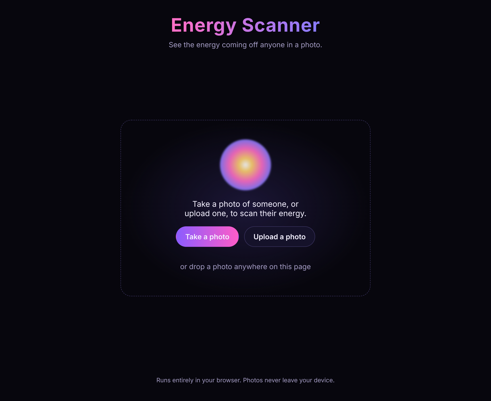
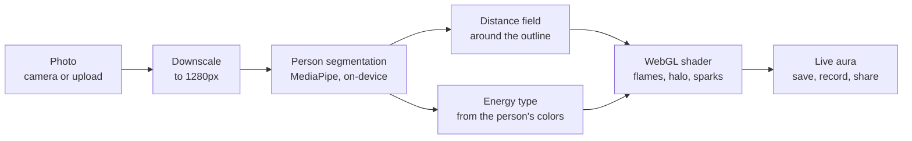

# Energy Scanner

**Take a photo of someone and watch their energy pour off them.** Energy Scanner finds the person in a photo and wraps them in an animated aura: flame-like light rising off their outline, colored by an "energy type" it reads from the photo. Save it as an image or a short video and share it.

Everything runs in your browser. **Photos never leave your device.** There is no server, no account and no tracking.

<p align="center">
  
</p>

<!-- Result screenshots (docs/screenshots/result-*.png, aura-*.png) are added from a photo that is cleared for publishing: npm run screenshots -- photo.jpg -->

## Try it

```bash
npm install
npm run dev        # open the printed localhost URL
```

1. **Take a photo** with your camera, or **upload** one (or drop it on the page).
2. The scanner finds the person and the aura blooms around them, live.
3. Switch the **energy type** (Radiant, Passion, Mystic, Calm, Vital, Spectrum) and the **intensity**.
4. **Save image**, **Save video**, or **Share** straight to your phone's share sheet.

## Why I built it

Most "AI photo" toys upload your face to someone's server. I wanted to see how far a delightful, visual product could go with zero backend: a person-segmentation model and a GPU shader running entirely on the phone in your pocket. It's also a small product exercise: one core moment (the aura blooming around you), cut everything that doesn't serve it, and make the result something people want to share. More in [CASE-STUDY.md](CASE-STUDY.md).

## How it works



- **Segmentation**: Google's MediaPipe selfie segmenter (a 250 KB model) runs in WebAssembly in the browser. The model and runtime are served by the app itself, so not even a CDN sees a request. An automated test checks that every request stays on the app's own origin.
- **Aura field**: the person mask becomes a signed distance field (an exact Euclidean distance transform), so every pixel knows how far it is from the person's outline.
- **Rendering**: a WebGL2 fragment shader turns that distance into rising flame tongues (domain-warped noise), a soft halo, outward waves, drifting sparks and a rim light along the body, and dims the background so the energy reads on any photo. Browsers without WebGL2 get a simpler Canvas 2D glow.
- **Energy type**: the "scan" reads the average color of the person (clothes, hair) and maps it to one of six energy types. It's for fun, and you can change it.
- **Export**: a captioned PNG, or a 4-second loop recorded from the live canvas with MediaRecorder (MP4 on Safari, WebM elsewhere), shared through the Web Share API on phones.

## Built with

TypeScript, Vite, WebGL2, MediaPipe Tasks Vision, MediaRecorder and Web Share APIs. Tested with Vitest (unit) and Playwright (real browser, including a fake camera).

```bash
npm run check      # lint + typecheck + unit tests
npm run build && npm run test:e2e   # browser tests in headless Chromium
```

## Privacy

- No uploads: the photo is decoded, segmented and rendered on your device.
- No network calls at all after the page loads, apart from the app's own model files.
- No analytics, cookies or accounts.

*Energy Scanner is for fun. It does not measure anything about a person.*
