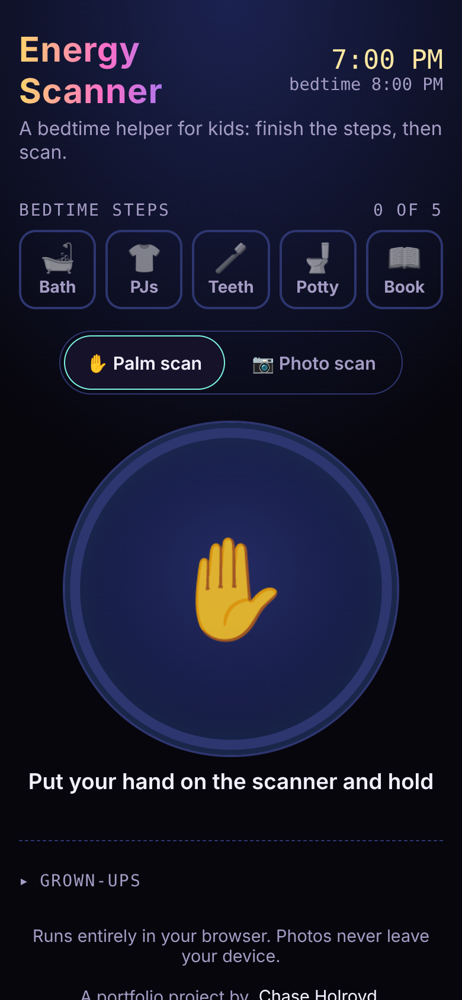
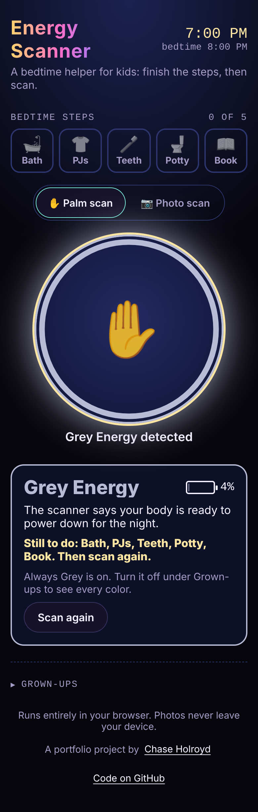
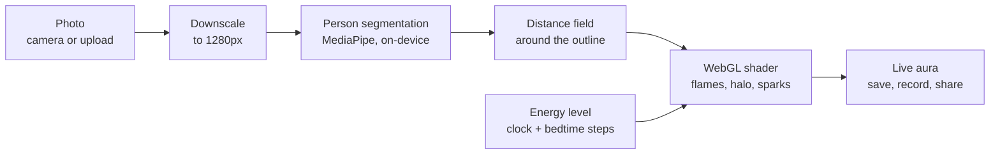

# Energy Scanner

**A bedtime helper for kids: finish your routine, then scan your energy.** Bedtime used to be a nightly negotiation. Energy Scanner lets a neutral machine say it's time instead of a parent. Kids tick off their bedtime steps, then scan: press and hold the palm pad, or take a photo and watch their energy glow off them as an animated aura. The color reads from Rainbow (way too much sparkle for sleeping) down to Grey (battery empty, time to recharge). A grown-up switch can make every scan read Grey.

Everything runs in your browser. **Photos never leave your device.** There is no server, no account and no tracking.

**Try it:** [chaseholroyd.com/energy-scanner](https://chaseholroyd.com/energy-scanner/), on a phone or laptop. No sign-up. No photo handy? Tap **Photo scan**, then **Try the sample**.

<p align="center">
  
  
  
  
</p>
<p align="center"><sub>The aura screenshots use the app's illustrated sample, not a real person.</sub></p>

## Run it locally

```bash
npm install
npm run dev        # open the printed localhost URL
```

1. Tick off the **bedtime steps**: Bath, PJs, Teeth, Potty, Book.
2. Pick the scan: **Palm scan** (press and hold until the ring fills) or **Photo scan** (take or upload a photo, or try the illustrated sample).
3. The reading shows an energy color, a battery level and what's left to do. In a photo scan the aura glows off the child in that color: softer and slower when sleepy, blazing when it's Rainbow.
4. Grown-ups set bedtime and the Always Grey switch, and can **Save** or **Share** a photo scan.

With the switch off, the reading follows the clock and the routine: the closer to bedtime and the more steps done, the sleepier the color. It never reads Rainbow once every step is done.

## Why I built it

Bedtime was a nightly negotiation with my kids. The first version was a palm scan: finish the routine, scan, and the machine says it's time. The obvious next step was a camera, but kids' faces should never go to a cloud model. So the photo scan runs entirely on the phone: a person-segmentation model and a GPU shader, no server, nothing uploaded. More in [CASE-STUDY.md](CASE-STUDY.md).

## How it works



- **Segmentation**: Google's MediaPipe selfie segmenter (a 250 KB model) runs in WebAssembly in the browser. The model and runtime are served by the app itself, so not even a CDN sees a request. An automated test checks that every request stays on the app's own origin.
- **Aura field**: the person mask becomes a signed distance field (an exact Euclidean distance transform), so every pixel knows how far it is from the person's outline.
- **Rendering**: a WebGL2 fragment shader turns that distance into rising flame tongues (domain-warped noise), a soft halo, outward waves, drifting sparks and a rim light along the body, and dims the background so the energy reads on any photo. Browsers without WebGL2 get a simpler Canvas 2D glow.
- **Energy level**: bedtime, the clock and the routine steps set an energy from 3 to 99, mapped to Grey, Blue Moon, Green Glow, Yellow, Red Rocket or Rainbow. That level picks the aura's colors and how strong and fast it moves.
- **Export**: a captioned PNG, or a 4-second loop recorded from the live canvas with MediaRecorder (MP4 on Safari, WebM elsewhere), shared through the Web Share API on phones.

## Built with

TypeScript, Vite, WebGL2, MediaPipe Tasks Vision, MediaRecorder and Web Share APIs. Tested with Vitest (unit) and Playwright (real browser).

```bash
npm run check      # lint + typecheck + unit tests
npm run build && npm run test:e2e   # browser tests in headless Chromium
```

## Privacy

- No uploads: the photo is decoded, segmented and rendered on your device.
- No network calls at all after the page loads, apart from the app's own model files.
- No analytics, cookies or accounts.

*Energy Scanner is for fun. It does not measure anything about a person.*

## License

Code: MIT ([LICENSE](LICENSE)). The bundled MediaPipe model and runtime are Apache 2.0 from Google; see [THIRD_PARTY_NOTICES.md](THIRD_PARTY_NOTICES.md).
